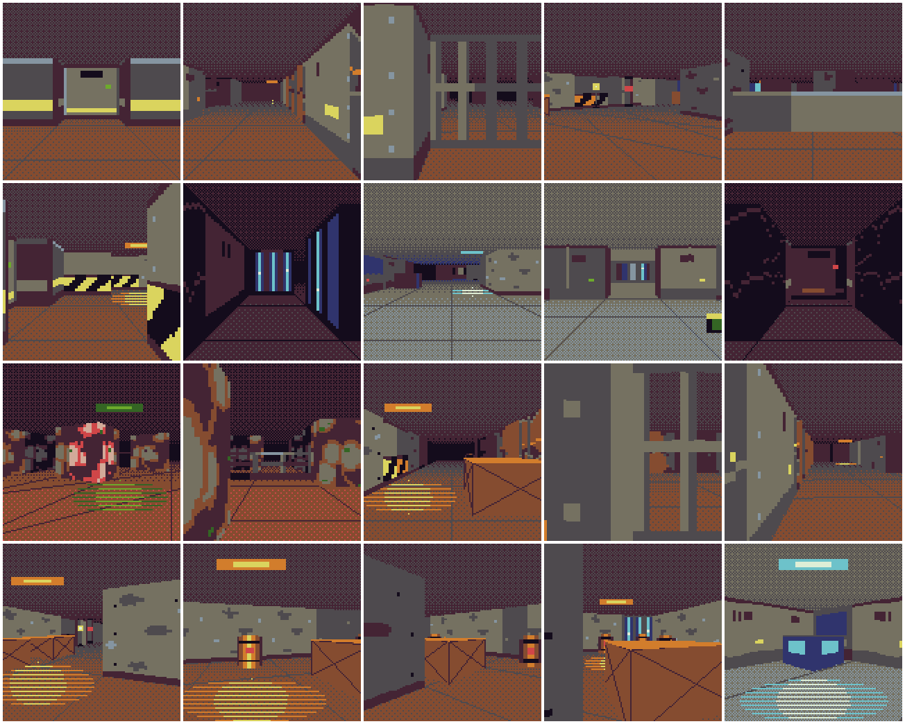
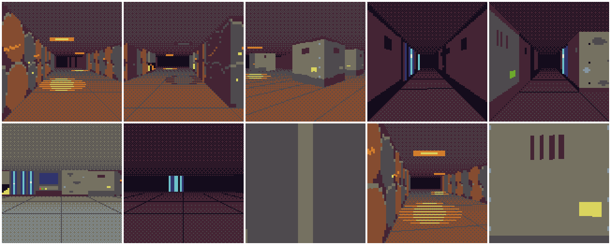

# NADIR — designdokument

Status: **godkänd plan (2026-10-29), implementeras enligt PLAN.md Part 4 (M26–M32). M26 byggd (D-040).** Detta dokument,
`LEVEL.md` (från M31) och banfilerna (`levels/*.map`) är specifikationen och testernas facit. Tabellerna med
konstanter (§3.3) och ljusregeln (§3.5) läses direkt av testerna i `test/nadir/`. Ändras ett värde här ska
motorn följa efter, aldrig tvärtom.

Alla cykel- och bytesiffror som inte är märkta *uppmätt* är **beräknade** ur VM:ens kostnadsmodell
(instruktionsräkning), inte mätta. Mätningarna förs in här och i `DECISIONS.md` när de görs.

---

## 0. Spelet på en minut

Djupforskningsstationen *Nadir* ligger 1 200 m ned i en nedlagd malmgruva. Borren slog igenom till ett hålrum,
och något självlysande växte ut i mörkret. Stationen tystnade. Du åker ensam ned i hisschaktet för att starta
kraften igen och få upp hissen, med en industriell bultbössa och en ficklampa.

Ett förstapersonsspel i retrostil: korridorer och rum i stål och råberg, varma natriumlampor som flimrar, kalla
cyanterminaler, röda larmljus, och en lila och grön infektion som lyser i mörkret. Spelet är en *vertical slice*:
**en bana på cirka tio minuter, ett vapen och två fiendetyper**, men så genomarbetat som maskinen tillåter.

Tre saker ska göra det till NADIR och inte en minimal raycaster:

1. **Ljuset berättar.** Mörkret är standard. Lampor, terminaler, ledningar och infektionen är det man ser, och
   ljuset (pölar, flimmer, ficklampan, mynningsblixten) är spelets stämning och vägvisare.
2. **Skarpa linjer i en låg upplösning.** Perspektivriktiga 1-px-linjer och silhuetter ovanpå 2-px-texturer gör
   att 128 × 128 ser skarpare ut än det borde.
3. **Varje effekt har en mätt kostnad.** Allt ligger inom 25 000 cykler per bildruta, i varje bildruta.

---

## 1. Låsta designbeslut (förslag)

1. **Runtime oförändrad.** VM, kassettformat, transport, QR och appen ändras inte (baslinje 932e534). Spelet
   använder ISA 2 som den är: xdata för grafiktillgångar som kopieras till RAM vid start.
2. **Renderare: hybrid kring en DDA-raycaster** (§3). 64 provkolumner à 2 px, RLE-texturer med LOD,
   1-px-silhuetter, ytvektordetaljer, `MAP`-bakgrund, ljus via tabeller, sprites som rektangellistor.
3. **Budget:** ≤ 25 000 cykler i varje bildruta av varje repris (hälften av VM:ens budget), ingen fault, inga
   överskridningar. 3D-vyn utan sprites ≤ 14 000 (M26-grinden).
4. **Omfång:** en bana (32 × 32 celler, ~10 min), ett vapen, två fiendetyper (Kryp, Spottare); bossen *Modern*
   bara om budgeten räcker efter M30.
5. **Kontroller "touch först"** (§5): en tumme håller bara en D-pad-riktning i appen, så varje vanlig kombination
   ska gå med en riktning plus A eller B.
6. **Ingen per-pixel-grafik.** Allt ritas med stora primitiver (`RECTFILL`, `LINE`, `MAP`, `SPR`).
7. **Text:** engelska versaler med den inbyggda 3 × 5-fonten (den saknar ÅÄÖ). Dokumentationen är på svenska.
8. **Stiliserat våld:** infektionens "blod" är grönt och lila. Inga människolik i detalj.

---

## 2. Maskinen (verifierat i källkoden)

| Egenskap | Verklighet | Konsekvens |
|---|---|---|
| Kostnad | 1 cykel per instruktion (även `MUL`, `DIV`, `MOD`, `LD`, `ST`), `SYS` = 8 cykler oavsett pixlar; `COPY`/`FILL` +⌈n/8⌉, `UNPACK` +⌈n/4⌉ | anropen är valutan, pixlarna är gratis; perspektivmatte är billig |
| Budget | 50 000 per anrop, `init` har egen; överskridning avbryter mitt i bilden | halvritade bilder syns, får aldrig hända |
| Aritmetik | 16 bitar; `MUL` = låga 16 bitar; `DIV`/`MOD` signerade; `LD/LDB/MOV/ST` sätter inga flaggor | fixpunkt; "high multiply" via byte-uppdelning |
| Grafik | 128 × 128, DB16, ingen framebuffer i minnet; `MAP` läser karta och tiles var som helst (även RAM), tile 0 ritas inte, färg 0 transparent; ingen skalning, ingen palettomväxling | skalning med geometri; `MAP` = gratis helskärmslager |
| Minne | ROM ≤ 32 KB, RAM 32 KB nollställt, stack nedåt från 0xFFFF | kod och heta tabeller i ROM, tillgångar i RAM |
| ISA | VM:en kör ISA 1 och 2; assemblern väljer ISA 2 när `.xdata` finns | tillgångar i xdata, ingen VM-ändring |
| Input | 6 knappar; appens touchknappar har pointer capture per knapp | en riktning per tumme |
| Ljud | 2 fyrkant + brus; ett nytt kommando ersätter kanalen; appen tonar varje ljud linjärt till 0 | drönare triggas om, prioritet per kanal |

---

## 3. Rendering

### 3.1 Teknikval

Jämförda: (A) klassisk raycaster med 128 strålar och en färg per kolumn (~18 000 cykler utan texturer, för dyr
för vad den ger), (B) få strålar med gradienter (~5 000, blockig), (D1) vägg-/segmentrenderare med
täckningslista (exakt men komplex i asm), (D2) dungeon crawler med förritade djupplatser (vacker men inte ett
FPS), (D3) trådram (billig men tunn). **Vald: (C) hybrid**, beräknat 11 100–16 800 cykler för 3D-vyn; grinden
14 000 kräver nedre halvan (interpolering och LOD).

Lagren (varje lager A/B-mäts i M26 och behålls bara om bilden vinner mer än det kostar):

1. **64 provkolumner** à 2 px, DDA på rutnätet med vinkeltabeller, fisheye-korrigerat. Mellankolumner kan
   interpoleras när båda grannarna träffar samma yta (1/z är linjärt i skärm-x för en plan yta).
2. **RLE-texturer:** varje texturkolumn är en grundfärg plus detaljspann (v0, v1, färg); ett spann = en
   `RECTFILL` skalad med väggens höjd. Tre LOD-nivåer efter vägghöjd.
3. **1-px-silhuetter:** grundfärgen ritas i 128 pixelkolumner med egen höjd (interpolerad inom samma yta), så
   väggens över- och underkant blir skarp trots 2-px-texturer.
4. **Ytvektordetaljer:** kolumner med samma yta bildar ett *ytspann*; horisontella och vertikala detaljer ritas
   som en `LINE` per detalj och spann, perspektivriktigt och utan aliasing.
5. **Golv och tak:** ett `MAP` med ditherade gradienttiles per zon, perspektivfogar (`LINE`), ljuspölar och
   takglöd (staplar av `RECTFILL`).
6. **Ljus via tabeller** (§3.5) och **färggradering** genom byte av skuggtabell.
7. **Sprites som rektangellistor** (M28) och **vapen, overlay och HUD med `MAP`/`SPR`** (M29–M30).

**Avgränsningar:** varierande vägghöjd fås som maskade väggar (låga väggar, räcken, fönster, hängande rör: strålen
noterar träffen och fortsätter till solid vägg, M27). Högre väggar eller tak per cell görs inte: taket är en
bakgrund som inte kan ockludera. Väggar ditheras inte (med 2-px-kolumner blir dither ränder); övergångar fås av
8 ljusnivåer. Dither används där `MAP` ger det gratis: golv, tak och overlay.

### 3.2 Koordinater och konventioner

- **Karta:** `MAP_W × MAP_H` celler, x österut (kolumn i `.map`-filen), y söderut (rad). Cellindex = y · 32 + x.
  Position i fixpunkt u8.8: 256 enheter per cell; cellen (x, y) täcker [x, x+1) × [y, y+1).
- **Vinkel:** u12, 4096 enheter per varv. Vinkel 0 = österut (+x), 1024 = söderut (+y). Eftersom y går söderut
  är *höger* i bilden ökande vinkel: höger-vektorn är (−sin θ, cos θ).
- **Provkolumn c** (0–63) täcker pixel x = 2c och 2c + 1. Strålen går genom kolumnens mitt x = 2c + 1:
  `camX = (2c + 1 − 64) / 64`, vinkelskillnad `off(c) = atan(camX · tan(FOV/2))`, tabellerad i vinkelenheter
  (avrundad). Strålens vinkel = spelarens vinkel + off(c) **+ ½ enhet**: strålens tabeller samplas på halva steg,
  så att en vinkel viks till sin kvadrant med en XOR (index 1023 − i är exakt komplementvinkeln).
- **Avstånd och höjd:** t = euklidiskt avstånd längs strålen till träffen; vinkelrätt avstånd
  `perp = t · cos(off(c) + ½)` (ingen fisheye). Vägghöjd `h = F256 / perp` px, räknad med **en** division:
  `h = ⌊colf[c] / t⌋` där `colf[c] = F256 / cos(off(c) + ½)` är förberäknad per kolumn. Djup lagras som `h`
  (invers djup): ljusregeln och sprites använder `h`, så `perp` behövs aldrig i ritningen. Överkant
  `top = HORIZON + bob − ⌊h/2⌋`, underkant `top + h`. Golvet och taket ligger på samma avstånd från ögat
  (ögonhöjd = halva väggen).
- **Interpolering:** jämna kolumner och kolumn 63 kastas. En udda kolumn interpoleras när båda grannarna träffar
  samma yta (h = medelvärdet, u perspektivriktigt), annars kastas den. Den kastas också när grannarnas höjder
  skiljer mer än en faktor 2 (en vägg i strykvinkel: kolumnvinklarna är heltal, så 1/z är bara nästan linjärt och
  felet växer med lutningen; M30 hittade 4 % fel på h där, D-046). Steg 4 med uppdelning mättes långsammare
  (ytorna byter för ofta).
- **Ytor:** `sida` 0 = västra ytan (strålen går mot +x), 1 = östra (−x), 2 = norra (+y), 3 = södra (−y).
  Yt-id = cellindex · 4 + sida.
- **Texturkoordinat u** (0–31, från vänster till höger sett framifrån): västra ytan `⌊frac(y_träff) · 32⌋`,
  södra ytan `⌊frac(x_träff) · 32⌋`, östra och norra ytan spegelvänt: `31 − ⌊frac(·) · 32⌋`.
- **Cellen framför** en yta = den tomma cell strålen var i före träffen (cellindex − steg). Dess ljus och zon
  gäller ytan.

### 3.3 Konstanter

| Konstant | Värde | Betydelse |
|---|---|---|
| `SCREEN_W` | 128 | bildens bredd och höjd i px |
| `COLS` | 64 | provkolumner per bildruta |
| `COL_W` | 2 | px per provkolumn |
| `HORIZON` | 64 | horisontens y i px (utan bob) |
| `FOV_DEG` | 66 | horisontellt synfält i grader |
| `ANGLES` | 4096 | vinkelenheter per varv |
| `CELL` | 256 | fixpunktsenheter per cell |
| `MAP_W` | 32 | kartans bredd i celler |
| `MAP_H` | 32 | kartans höjd i celler |
| `TEX` | 32 | texlar per cell i u och v |
| `F256` | 25229 | ⌊64 / tan(FOV/2) · 256 + ½⌋: vägghöjd i px = F256 / perp |
| `PERP_MIN` | 13 | minsta vinkelräta avstånd (u8.8, 0,05 cell) |
| `MAX_SIGHT` | 13 | längsta fria siktlinje i celler från en gåbar cells mittpunkt (banregel, §7); begränsar DDA-stegen utan räknare i inre loopen |
| `FOG_NEAR_Q` | 10 | dimman börjar efter 10 kvartsceller (2,5 celler) |
| `FOG_STEP_Q` | 7 | därefter en ljusnivå mörkare per 7 kvartsceller (svart efter 13 celler) |
| `FL_RANGE_Q` | 24 | ficklampan når 24 kvartsceller (6 celler) |
| `LOD1_H` | 48 | väggar lägre än 48 px använder LOD 1 (16 × 16 texlar) |
| `LOD2_H` | 20 | väggar lägre än 20 px använder LOD 2 (8 × 8 texlar) |
| `FEAT_H` | 24 | ytvektordetaljer ritas bara på ytspann där någon kolumn är minst 24 px hög |
| `FLICK_SHIFT` | 2 | flimmermönstret går ett steg var 4:e bildruta |
| `LEVELS` | 8 | ljusnivåer, 0 = fullt ljus, 7 = svart |

### 3.4 Numeriska format

| Storhet | Format | Not |
|---|---|---|
| Position | u8.8 | jämförs med `JB/JAE` |
| Vinkel | u12 | |
| sin, 1/\|cos\| | halvstegstabeller (1 024 ord vardera): s1.14 och u8.8 klämd vid 64 celler | 2 + 2 KB ROM |
| t, sideDist | u8.8 | `frac · delta` med byte-uppdelad multiplikation |
| `colf[c]` | F256 / cos(off(c) + ½) | h = colf / t, en `DIV` |
| Vägghöjd h | heltal px, ≤ 512 (t ≥ ¼ cell) | används också som invers djup |
| Texturkoordinat | bråkdelen ur låga 16 bitar av t (u8.6) · \|sin\| (u0.10), plus kamerans bråkdel | `MUL` ger exakt bråkdelen |
| Ljusnivå | 0–7 | |

### 3.5 Ljusregeln

För varje provkolumn med en träff:

```
q     = ⌊F256 / (64 · min(h, 255))⌋                  (avståndet i kvartsceller, ur väggens höjd h)
fog   = 0 om q < FOG_NEAR_Q, annars min(7, 1 + (q − FOG_NEAR_Q) div FOG_STEP_Q)
ljus  = max(statisk, flimmer om gruppen är tänd, annars 0)       (cellen framför, ljuskartan)
kägla = KÄGLA[c] om ficklampan är på och q < FL_RANGE_Q, annars 0
nivå  = klämd(fog + amb(zon) − ljus − kägla − blixt, 0, 7)
```

- **Ljuskartan** har en byte per cell: bit 0–2 statiskt ljus (0–7), bit 3–5 flimrande ljus (0–7), bit 6–7
  flimmergrupp (0–3). Den räknas offline ur banans lampor: en lampa med styrka I lyser upp en tom cell med
  `max(0, I − ⌊d⌋)`, där d är avståndet mellan cellernas mittpunkter i celler, om sträckan mellan mittpunkterna
  är fri. *Fri* betyder att ingen av de 63 punkterna `A + (B − A) · k/64` (k = 1…63) ligger i en solid cell.
  Statiskt ljus = största bidraget från lampor i grupp 0; flimrande ljus och grupp = största bidraget från
  lampor i grupp 1–3 (vid lika vinner lägsta grupp).
- **Flimmer:** grupp g är tänd i bildruta n om tecken nummer `(tick >> FLICK_SHIFT) & 31` i mönstret nedan är
  `1` (`tick` = spelets bildräknare i RAM efter uppdateringen).

| Grupp | Mönster (32 steg) | Karaktär |
|---|---|---|
| 0 | `11111111111111111111111111111111` | fast |
| 1 | `11111111111110111111111111100111` | nästan stadig, korta avbrott |
| 2 | `10110011111100001111101101110001` | trasig lampa |
| 3 | `11111111111111110000000000000000` | långsam puls (larm) |

- **Kägla** (ficklampan) per provkolumn:

| Kägla | Provkolumner |
|---|---|
| 2 | 28–35 |
| 1 | 24–27, 36–39 |

  övriga kolumner 0.
- **Zoner:** `amb` är zonens mörker. Zonen bestämmer också skuggtabellsatsen (dimfärgen), golv- och takets
  basfärg (§3.7) och ljuspölarnas färg.

| Zon | Namn | `amb` | Dimfärg | Golvramp (nära → långt bort) | Takramp | Ljusfärg | Ljuskant |
|---|---|---|---|---|---|---|---|
| 0 | schaktet | 2 | 4 | 7 4 3 1 0 | 3 1 0 | 14 | 9 |
| 1 | labbet | 1 | 2 | 10 7 3 2 0 | 7 3 2 0 | 15 | 13 |
| 2 | kärnan | 2 | 1 | 6 4 1 0 | 1 0 | 11 | 5 |
| 3 | mörkret | 3 | 0 | 3 1 0 | 1 0 | 7 | 3 |

- **blixt** är mynningsblixten (M29), annars 0.
- **Skuggtabeller:** en tabell per zon och ljusnivå, 32 byte: index 0–15 är vanliga färger, 16–31 är
  *emissiva* versioner av samma färger. En texel med färg k och nivå L ritas med färgen `tabell[zon][L][k]`.
  Vanliga färger mörknar mot zonens dimfärg och är svarta (0) på nivå 7. Emissiva färger behåller sin färg till
  nivå 5 och mörknar först därefter. Tabellerna skrivs av `tools/tables.ts` (perceptuellt närmaste DB16-färg till
  färgen skalad med nivåns ljusstyrka och blandad mot zonens dimfärg) och kontrolleras: ljusstyrkan avtar aldrig
  uppåt med nivån, och vanliga färger är 0 på nivå 7.

### 3.6 Texturer

- Ett material är 32 × 32 texlar med en egen teckenförklaring (`art/textures.txt`, eller procedurellt med fast
  seed i `tools/textures.ts`). Färg 16–31 betyder emissiv.
- Lagras per LOD k (0, 1, 2) med `32 >> k` kolumner. En kolumn är **en grundfärg och en lista med detaljspann**
  `(v0, v1, färg)` i 1/32-delar av väggens höjd (även på LOD 1 och 2, då i steg om 2 och 4). Generatorn väljer
  den grundfärg som ger färst spann och slår ihop lika grannspann. LOD 1 och 2 skapas genom att ta den vanligaste
  färgen i varje 2 × 2- respektive 4 × 4-block (emissiva färger vinner, så att lampor inte försvinner på avstånd).
- **Ytvektordetaljer** per material: horisontell linje `h v färg u0 u1` eller vertikal linje `v u färg v0 v1`
  (koordinater i 1/32), ritade i ytspann där någon kolumn är minst `FEAT_H` px hög.
- **Animation:** ett material kan ha u-scroll (texeln flyttas en kolumn var 2^s:te bildruta) eller två
  bildrutor.
- Texturerna ligger i xdata och kopieras till RAM i `init`. **LOD 0-kolumnerna är kompilerad kod:** generatorn
  skriver varje unik kolumn som rak maskinkod (grundfärg och spann med v-gränser och färg som immediates, ingen
  slinga), den ligger i xdata, kopieras till RAM och **anropas där** (VM:en hämtar instruktioner var som helst i
  minnet). Ett spann kostar då 11 instruktioner + `RECTFILL` i stället för ~18 + `RECTFILL`. LOD 1 och 2 är data.

### 3.7 Golv och tak

- **Bakgrund:** ett `MAP` med 16 × 18 tiles från zonens tileset, ritat på y = bob − 8: rad 0–8 tak, rad 9–17
  golv. Varje tilerad är en ditherad (Bayer 4 × 4) gradient mellan två steg i zonens tak- respektive golvramp,
  mörkast vid horisonten (långt bort) och ljusast vid bildens kant (nära). Alla tiles är helt täckande.
- **Perspektivfogar:** golvets rutnätslinjer (x = k och y = k) inom 6 celler, ritade med `LINE` före väggarna
  (väggarna döljer det som ligger bakom). Allt som bara beror på kamerans vinkel ligger i en **tabell i xdata**,
  ett 16-byteskort per 1/1024 varv (`floor.gen.asm`, 16 KB), som hämtas med en `COPY` (10 cykler): de *radiella*
  fogarna (familjen mest längs blicken) går mellan raderna `FL_YB` och `FL_YF` med x = XV − steg · d, de
  *korsande* över hela bredden med y = horisont + PP / d (d = linje − kamera). Per linje återstår additioner.
  Korsande fogar ritas bara inom 3 celler (längre bort blir de ränder vid horisonten). Färg: zonens golvramp,
  tredje steget.
- **Lampor:** varje lampa inom 8 celler och minst 0,6 cell framför kameran ritas som en armatur i taket (ett ljust
  streck i en ram, ~h/2 bred) och en **ljuspöl** på golvet: en ellips (halvbredd 0,55 h) av horisontella `LINE` på
  varannan rad, ytterdel i zonens ljuskant och mitt i ljusfärgen; raderna växlar med bildrutan så att pölen
  skimrar. En släckt flimmerlampa ritas mörk.

### 3.8 Pipeline och ocklusion

```
logik → kamera (sin/cos, bob, skak, ljusläge, flimmer)
→ 1 bakgrund (MAP) → 2 golv/tak-detaljer (fogar, pölar, glöd)
→ 3 strålar (64 provkolumner, interpolering) → kolumnbuffertar: perp, h, yta, u, material, nivå, cellen framför
→ 4 väggar: silhuett (1 px) → detaljspann (2 px) → ytvektordetaljer
→ 5 sprites och maskade ytspann bak→fram, klippta mot z-bufferten (M27–M28)
→ 6 partiklar → 7 vapen → 8 overlay → 9 HUD → 10 ljud
```

Golvet bakom en vägg skrivs över av väggkolumnen. Sprites klipps per kolumnintervall mot perp. Maskade väggar
sorteras med sprites på sitt djup. Vapen, overlay och HUD sist.

### 3.9 Vad som räknas var

| När | Vad |
|---|---|
| Offline | trigtabeller, kolumnvinklar och cos, skuggtabeller, texturer → spann + LOD + detaljer, sprites → rektanglar, ljuskarta, zoner, rum och "nästa rum"-tabell, siktlinjekontroll, kamerapositioner |
| `init` | kopiera tillgångar xdata → RAM, packa upp banan |
| Per bildruta | kamera, flimmer, strålar och kolumner, sprites, AI, partiklar, ljud |
| Vid händelser | dörrlägen, checkpoint (`COPY` av tillståndsblocket), zonbyte, färggradering |

### 3.10 Kartan, dörrar och maskade väggar (M27)

**Kartbyte** (en byte per cell i RAM, index y · 32 + x):

| Byte | Betydelse |
|---|---|
| 0 | golv |
| 1–31 | solid vägg av material id (ordningen i `art/textures.txt`) |
| `0x40 \| i` | dörr i (0–15) i dörrtabellen |
| `0x80 \| o · 0x20 \| m` | maskad tunn vägg av material m; o = orientering |

**Tunna celler** (dörrar och maskade väggar) har ett plan genom cellens mitt. Orienteringen härleds av generatorn:
väggar (för en maskad cell även andra tunna celler) i norr och söder och golv i väster och öster ger planet
x = cx + ½ (o = 1), väggar i väster och öster och golv i norr och söder ger y = cy + ½ (o = 0); annat är fel. En
dörr kräver väggar på båda sidor (karmen, material F, ritas som vanliga väggar).

**Strålen** går in i en tunn cell genom vilken sida som helst. Med sideX/sideY = avståndet till nästa x- och
y-korsning efter steget in i cellen och dX/dY deltan är planets träffavstånd för o = 1 `tp = sideX − dX/2`
(heltal, dX/2 avrundat nedåt) och för o = 0 `tp = sideY − dY/2`. Planet träffas om tp ligger inom cellen:
`t_in ≤ tp < sideY` (o = 1) respektive `t_in ≤ tp < sideX` (o = 0), där t_in är avståndet där strålen gick in i
cellen. Annars fortsätter strålen. Ytan får sidan för planets axel (som en x- respektive y-träff), cellen framför
är cellen före planet längs den axeln (cellindex − stegX respektive − stegY), texturens u räknas som för en vanlig
yta i träffpunkten.

- **Dörrar** skjuts i sidled längs planet. `open` = 0–256 (andel av cellbredden i u8.8). Strålen passerar där
  träffpunktens bråkdel längs planet är mindre än `open`, annars träffar den dörren med u av `bråkdel − open`
  (dörrbladet glider ut ur bilden). Material: `D` dörr, `E` låst dörr (röd lampa) så länge nyckeln saknas.
- **Maskade väggar** (`G` galler, `W` fönster, `L` räcke, `K` låg vägg): materialet har genomskinliga texlar
  (`t` i teckenförklaringen). Strålen registrerar det **första** maskade planet (yta, h, u, material, cellen
  framför) och fortsätter till en solid vägg; ett andra maskat plan längs samma stråle ignoreras (banregel: inga
  två i följd i sikte). Maskade kolumner har ingen grundfärg: bara de täckande spannen ritas, efter alla väggar,
  med samma ljusregel (cellen framför planet). En udda kolumn interpoleras bara om båda grannarna har samma
  maskade yta (eller ingen), och då interpoleras även det maskade lagret.

**Dörrtabell** (16 byte per dörr i RAM): cell (ord), `open` (ord), läge, timer, orientering, nyckelbit, material,
grundmaterial, räckvidd (ord). Varje bildruta, efter spelaren, för varje dörr (dörrens mittpunkt (cx + ½, cy + ½),
*nära* = spelarens position inom dörrens räckvidd från mittpunkten i både x och y (strikt mindre), *tillåten* =
nyckelbit 0 eller nyckeln finns). Räckvidden är `DOOR_REACH`; en **dold dörr** (M31, LEVEL.md: hemligheterna) har
väggens material som grundmaterial och räckvidden `HIDE_REACH`, så den öppnas bara när spelaren står mot den.

| Läge | Regel |
|---|---|
| 0 STÄNGD | nära och tillåten → ÖPPNAR |
| 1 ÖPPNAR | open += `DOOR_SPEED`; vid open ≥ 256: open = 256, ÖPPEN, timer = `DOOR_WAIT` |
| 2 ÖPPEN | nära → timer = `DOOR_WAIT`, annars timer − 1; timer 0 → STÄNGER |
| 3 STÄNGER | nära och tillåten → ÖPPNAR; annars open −= `DOOR_SPEED`; vid open ≤ 0: open = 0, STÄNGD |

Ett lägesbyte till ÖPPNAR flyttar inte dörren i samma bildruta. En dörr öppnas alltså på 256 / `DOOR_SPEED`
bildrutor efter att den börjat röra sig. Spelaren kan bara gå in i en dörrcell som är helt öppen (open = 256), och
eftersom `DOOR_REACH` är större än spelarens halva låda plus en halv cell kan dörren inte stänga på spelaren.
**Nycklar:** står spelaren i en nyckelcell (`keys` i banfilen) sätts nyckelbiten.

| Konstant | Värde | Betydelse |
|---|---|---|
| `DOOR_SPEED` | 8 | dörrens rörelse per bildruta (u8.8): 32 bildrutor att öppna |
| `DOOR_WAIT` | 90 | bildrutor en öppen dörr väntar efter att spelaren gått |
| `DOOR_REACH` | 384 | avstånd (u8.8, per axel) från dörrens mitt som öppnar den: 1,5 celler |
| `HIDE_REACH` | 208 | en dold dörrs räckvidd: spelaren mot väggen (½ cell + `P_RAD` = 192 < 208) |

### 3.11 Adaptiv pacing (M27–M30)

En bild kostar strålar (fas 1) plus ritning (fas 2). Faserna är var för sig långt under 25 000 cykler, men
tillsammans kan de gå över. Därför skattas bildens kostnad efter fas 1 (strålar och spriteurval) med
`PACE_W_CAST` · kastade strålar + `PACE_W_MASK` · maskade kolumner + `PACE_W_RECT` · spriterektanglar (efter
budgeten); är skattningen minst `PACE_EST` ritas bilden i **nästa** bildruta. Den bildrutan kör spelarens logik och
sedan bara ritningen; skärmen visar föregående bild under tiden (framebuffern ligger kvar). Bilden ritas från
**bildens kamera** (`rcam_x`, `rcam_y`, `rcam_a`, `rbob`, `rtick`: kameran och bildrutan när strålarna kastades),
inte spelarens nya position. Spelets logik går alltid i 60 bildrutor/s; bara bildtakten sjunker till 30/s i sådana
vyer. `FL_NOPACE` stänger av pacingen.

Vikterna är en minstakvadratanpassning av hela bildens kostnad mot de tre talen över alla repriser i M28 (19 196
bildrutor utan pacing; största underskattning 4 703 cykler). Gränsen valdes efter mätning med marginal: med 8 000
kostar ingen bildruta i repriserna mer än 24 402 (M27: en enklare regel, minst 8 maskade kolumner). Material som
inte är kompilerade (`nocompile`, organiskt i kärnan) ingår inte i skattningen; de syns i marginalen.

**M29:** spelets logik (fiender, vapen, HUD) kostar ~1 000–1 500 cykler i varje bildruta, så gränsen sänktes till
7 000 efter mätning. **Tunga bilder:** är skattningen redan efter strålarna (utan spritarna) minst `PACE_HEAVY`
tar bilden **tre** bildrutor: strålarna, sedan spriteurvalet (`pace` = 2), sedan ritningen (`pace` = 1), alltid
från bildens kamera. Det gäller de dyraste vyerna (maskade väggar och många föremål, ~5 % av bilderna i
repriserna): sådana bilder kostar upp till ~50 000 cykler och ryms inte på två bildrutor med logiken. Mätt med
7 000 / 14 000: ingen bildruta i de åtta repriserna över 24 388 (D-045).

**M30:** skattningen räknar också `PACE_W_PART` per levande partikel och `PACE_W_EN` per vaken fiende (§6.9). En
bildruta vars logik avfyrar vapnet eller spränger en tunna (`lg_heavy`, skott: ~6 000 cykler med fyra mål och
tunnor) gör **inget** renderingssteg: varken strålar, spriteurval eller ritning; bilden väntar en bildruta. Mätt:
ingen bildruta i de nio repriserna (med stressreprisen) över 24 597 (D-046).

| Konstant | Värde | Betydelse |
|---|---|---|
| `PACE_HEAVY` | 12000 | skattningen efter strålarna som gör att bilden tar tre bildrutor |
| `PACE_W_CAST` | 264 | vikt per kastad stråle |
| `PACE_W_MASK` | 160 | vikt per maskad kolumn |
| `PACE_W_RECT` | 164 | vikt per spriterektangel |
| `PACE_EST` | 6000 | skattningen som gör att bilden ritas i nästa bildruta |

### 3.12 Sprites och rekvisita (M28)

**Rect sprites.** En spritebild är en lista rektanglar `(x0, y0, x1, y1, färg)` i källpixlar (x1, y1 exklusiva),
ritade i ordning: en senare rektangel skriver över en tidigare. Ingen rektangel täcker en genomskinlig källpixel.
Generatorn (`tools/sprites.ts`) bygger listan lager för lager (en färg i taget, rektanglar som bara täcker den
färgens pixlar eller pixlar som en senare färg skriver över) och prövar flera färgordningar. LOD 1 och 2 är källan
nedsamplad 2 × 2 respektive 4 × 4 (vanligaste värdet i blocket, genomskinligt räknas som ett värde; emissiva färger
vinner om de täcker en fjärdedel), kompilerade på samma sätt. Gränser: LOD 0 ≤ 48, LOD 1 ≤ 20, LOD 2 ≤ 8 rektanglar.

**Skalning.** `s` = skärmstorlek per källpixel i 1/64 px. Alla LOD:ers rektanglar lagras i källpixlar (LOD k:s
block är 2^k källpixlar, klippta till källans storlek så att en LOD aldrig blir större än källan). En kant v hamnar på
`bas + (v · s + 32) >> 6`, samma formel för start och slut, så grannrektanglar delar kanter. Med s = 64 · n blir det
exakt n gånger förstoring med närmaste granne.

**Typer** (`art/sprites.txt`): källbild (≤ 16 × 24), höjd i procent av väggen, blockerande halvlåda (u8.8, 0 =
genomgångbar) och plockbar sort (0 = nej, 1 = medkit, 2 = ammunition). K = round(höjd% / 100 · 2048 / källhöjd).

**Projektion** av en prop i (px, py) (u8.8), med dx = px − rcam_x, dy = py − rcam_y och bildens cos/sin i s1.12
(halvstegstabellen sin_h >> 2): z = dx · cos + dy · sin, lat = dy · cos − dx · sin, räknade i 1/1024 cell (var
produkt / 1024 avrundad, bytevis delad); h med bråket f i åttondelar: h8 = 8 ⌊F256 / z⌋ + round(8 (F256 mod z) / z) med z avrundad
till u8.8; men för en sprite närmare än ~1 cell (z₁₀₂₄ < 1008) från z räknat en gång till i 1/4096 cell (de
oavrundade produkterna summerade): h8 = round(128 F256 / z₄₀₉₆), heltalet och fyra steg om 2 bitar med 16-bitars
divisioner (M29: en Kryp 0,25 cell bort är 270 px hög och behöver z på ±0,1 %); h = h8 >> 3, f = h8 & 7;
`s = ((h + f/8) · K) / 32` (1/64 px), spritens höjd `hgt = (källhöjd · s + 32) >> 6`, bredd
`wid = (källbredd · s + 32) >> 6`, mitt `cx = 64 + lat · (h + f/8) / 256` (produkterna avrundade), vänsterkant `cx − wid / 2`, underkant på golvet `hor + h / 2`, överkant
underkant − hgt. Testet jämför mitt-x och höjd med flyttal (±1 px). En prop ritas om z ≥ `SPR_NEAR`, z ≤ `SPR_FAR` och lådan [vänster,
vänster + wid) når in i [0, 128). LOD efter hgt: ≥ `SPR_LOD1_H` → 0, ≥ `SPR_LOD2_H` → 1, annars 2.

**Urval, ordning och budget.** De synliga sorteras på z, längst bort först; är de fler än `SPR_MAX` stryks de
längst bort. Summan av deras rektanglar får vara högst `SPR_RECTS`: så länge den är större sänks den sprite
som ligger längst bort och inte redan har LOD 2 ett steg (varvet börjar om längst bort). De ritas längst bort först.

**Tabeller per cell (PVS, i xdata).** Generatorn räknar för varje cell vilka props som kan synas därifrån (en fri
linje från någon av 6 × 6 punkter i cellen till någon av 5 punkter i propens fotavtryck, högst `SPR_FAR` + 1 cell,
dörrar öppna, maskade väggar genomskinliga) och vilka som ligger nära (fotavtrycket inom en cell). Bilden hämtar
kamerans celler med en `COPY` (6 byte); bara de möjligen synliga projiceras, bara de nära prövas för kollision och
plock. Före den exakta projektionen gallras dessutom med en grov kon (5-bitarskoordinater).

**Ocklusion.** Provkolumn c visar spriten om spritens h > `col_h[c]` (spriten är närmare än väggen). Spriten ritas
i intervall av sådana kolumner (rektanglarna klipps i x). `spr_h[c]` = största h bland spritarna som syns i c. Ett
maskat plan i kolumn c ritas **före** spritarna om dess h ≤ `spr_h[c]` och annars **efter** (en kolumn med en
sprite bakom ett galler och en annan framför ritar gallret före båda: dokumenterad begränsning).

**Ljus.** Spritens cell ger spannljuset (§3.5); nivån = clamp_tab[fogtabellen för kolumnen under mitten
(cx / 2, klämd) vid spritens h + spannljuset]; färg via zonens skuggtabell (emissiva färger lyser).

**3D-lådor (M28b, D-044).** Föremål som är kantiga sedda uppifrån (lådor, konsoler) är riktiga axelparallella
lådor i stället för billboards; runda (tunnor, rör, lampor) och plockbara förblir billboards. En lådtyp
(`sprite <tecken> <namn> box`, raden `box <sida> <lock> <linje> <stil>`) har kvadratiskt fotavtryck ±block (samma
som kollisionens halvlåda), höjd i procent av väggen (< 50: under ögat, så locket syns) och K = round(höjd · 256 / 100).
- *Hörn.* Vid urvalet transformeras de fyra hörnen (−a, −a), (+a, −a), (+a, +a), (−a, +a) till kamerarymd (z, lat i
  1/1024 cell: mittens produkter som spritarna plus ±a · cos, ±a · sin) och projiceras: x i 1/16 px =
  1024 + lat · h8 / 512, h8 = 8 · F256 / z med avrundat bråk (pinnad 256 px utanför bild om |lat| ≥ 8z). z för
  sortering = lådans mitt; skärmlådan = hörnens x och golv-/lockrader; ett hörn bakom `BOX_NEAR` → hela skärmen.
  Kostnad i budgeten och pacingen (§3.11): 4 + ⌊bredd / 6⌋ rektanglar, en konsol (skärmarna: en andra fyllning)
  4 + 2 · ⌊bredd / 6⌋.
- *Sidor.* Synlig är västsidan om kamerans x < lådans väst, östsidan om x > öst, likadant nord/syd (högst två). En sida
  klipps (exakt, a · b / c) mot z ≥ `BOX_NEAR` och mot linjerna |lat| = 7,5z, projiceras, och fylls i provkolumnerna vars mitt
  (32c + 16, 1/16 px) ligger i [xa, xb): h (åttondelar) är exakt i första och sista kolumnen (32-bitars a · b / c) och
  stegas linjärt däremellan (h är linjärt i skärm-x på ett plan); kolumnen ritas där h > `col_h[c]` från överkanten
  `hor + round(h · (128 − K) / 256)` till golvet `hor + h − h / 2` (väggarnas golvlinje). Färg: sidans materialfärg
  med kolumnens ljusnivå enligt väggarnas regel (§3.5: lådcellens spannljus, kolumnens dimma och kon vid h), väst- och
  östsidor en nivå mörkare.
- *Detaljer* (bara när största hörn-h ≥ `BOX_DETAIL` och sidan inte klippts): en låda får ram (övre kant, båda ändar)
  och kryss i linjefärgen, klippta till sidans synliga kolumner; en konsol får en emissiv skärm (20–80 % av bredden,
  45–85 % av höjden).
- *Lock* (samma villkor, inget hörn bakom): de fyra övre hörnen på skärmen fylls rad för rad mellan kanterna (x per
  kant stegat i 1/64 px), klippt till lådans synliga kolumner, en nivå ljusare. Begränsning: en vägg som skär
  lådans synliga spann i två delar klipper inte locket (sällsynt; dokumenterad).
- *Test:* per kolumn sparas närmaste ritade lådsida (`col_bface` = prop · 4 + sida, `col_bh`, `col_btop`,
  `col_blvl`) och jämförs med en flyttalsstråle mot lådans AABB (`ref.ts`, slab-test).

**Blockerande props** är lådor ±halvlåda: spelarens låda (±`P_RAD`) får aldrig överlappa dem (strikt olikhet per
axel, |spelare − prop| < `P_RAD` + halvlåda är överlapp); de ingår i kollisionens "passerbar" (§5 steg 5). **Plock:**
efter spelarens rörelse plockas en levande plockbar prop vars avstånd per axel är < `P_RAD` + `PICK_HALF`; den
försvinner och räknas (`picked_med`, `picked_ammo`).

| Konstant | Värde | Betydelse |
|---|---|---|
| `SPR_NEAR` | 64 | närmaste djup som ritas (u8.8, 0,25 cell) |
| `SPR_FAR` | 3328 | längsta djup som ritas (13 celler) |
| `SPR_MAX` | 8 | flest synliga sprites per bild |
| `SPR_RECTS` | 96 | rektangelbudget per bild |
| `SPR_LOD1_H` | 24 | sprites lägre än så (px) använder LOD 1 |
| `SPR_LOD2_H` | 10 | sprites lägre än så använder LOD 2 |
| `PICK_HALF` | 64 | plockradie per axel utöver spelarens låda (u8.8) |
| `BOX_NEAR` | 32 | lådornas närplan (u8.8, 0,125 cell; spelaren står ≥ 0,25 från en sida, så en synlig sida ligger på z ≥ 0,21) |
| `BOX_DETAIL` | 32 | lådor vars största hörn-h är lägre (px) ritas utan lock och linjer |

---

## 4. Grafiskt koncept

**Palettroller (DB16):** skugga/dimma 0 1 2 3 · stål 3 7 10 15 · berg 1 4 3 7 · natrium 14 9 4 · teknik 13 8 2 ·
larm 6 1 · infektion 12 6 1 + glöd 11 5.

**Zoner:** *schaktet* (varmt, dimma mot brunt), *labbet* (kallt, dimma mot marinblått), *kärnan* (lila), och
*mörkret* (högt amb, bara ficklampan och emissiva detaljer).

**Material:** stålpanel med nitar · sprutbetong · råberg med malmådror · industripanel med rör ·
varningsränder · lysande energiledning (emissiv, u-scroll) · terminalvägg (emissiv skärm, 2 bildrutor) ·
skjutdörr med status-LED · dörrkarm · galler (maskat) · organisk vägg (pulserande sporer) · hisschakt. Regel:
bara detaljer som syns vid 128 × 128; tunna detaljer blir ytvektorlinjer i stället för texlar.

**Fiender:** *Kryp* (blek, lemmalång, röda emissiva ögon, snabb närstrid med tydlig upptakt) och *Spottare*
(uppsvälld, lila med lysande gröna säckar, spottar syra). Kantljus i spriten ger silhuett mot mörkret.

**Vapen:** bultbössa (pumphagel), ~64 × 48 px med ett `MAP`; bob, sväng, rekyl, pump, omladdning,
mynningsblixt, bärnstensfärgad emissiv ammunitionsdisplay.

**HUD:** helskärms-3D, hälsa nere till vänster, ammunition på vapnet, nyckelkort uppe till vänster, litet sikte,
skaderiktning i kanten, vinjett som ram.

**Effekter och kostnad (beräknad):**

| Effekt | Funktion | Kostnad |
|---|---|---|
| Avståndsdimma | djup, döljer låg upplösning, kortar siktlinjer | ~3 instr per kolumn |
| Ljuskarta + flimmer | ljuspölar, mörka partier, liv | ~5 instr per kolumn |
| Emissiva texlar | lampor, skärmar och ögon syns i mörker | 0 (del av skuggtabellen) |
| Zonvis färggradering, tint | identitet per område, feedback | 0 (byte av tabellpekare) |
| Ditherat golv/tak | djup på stora ytor | 1 `MAP` ≈ 20 cykler |
| Perspektivfogar | rörelsekänsla, perspektiv | ~50 cykler per linje |
| Ljuspölar och takglöd | lampornas ljus landar | ~10 `RECTFILL` per lampa |
| Ficklampskägla | stämning, fokus | ~2 instr per kolumn |
| Mynningsblixt | skott lyser upp scenen | 0 + 1 `MAP` |
| Vinjett, skadeblink | ram, feedback | 1 `MAP` vardera |
| Skärmskak | tyngd | 0 (offset) |
| Partiklar | träffar, explosioner | ~30 cykler styck, tak 24 |

---

## 5. Kontroller och spelaren (M27)

| Knapp | Funktion (S1, standard sedan M29: människans val) |
|---|---|
| UPP | gå framåt |
| NED | gå bakåt |
| VÄNSTER / HÖGER | vrid; ett tryck = fin vridning, håll = accelererar |
| B + VÄNSTER / HÖGER | gå i sidled med `WALK_MAX` (ingen vridning); B ensam gör inget |
| dubbeltryck VÄNSTER/HÖGER (utan B) | snabbt sidosteg åt det hållet |
| A | skjut (M29) |
| dörrar, nycklar | öppnas och plockas när man går in i dem |

**S2** (RAM-flaggan `ctl_s1` = 0; S1 är 1 och sätts av init): B håller man för att gå framåt (för en touchspelare
som vill gå med högertummen och styra med vänstertummen), inget sidledsgående med B. Människan provade S2 på
telefonen och ville hellre gå med UPP och gå i sidled med B (M29), så S1 är standard; valet kan ligga på
titelskärmen (M31).

**Spelaren, per bildruta i denna ordning** (positioner u8.8, vinkel u12; cos/sin s.8 = ⌊S(a) / 64⌋ med
S(a) = tecken · round(|sin((a + ½) · 2π / 4096)| · 16384), dvs. halvstegstabellen sin_h; cos a = sin(a + 1024)):

1. **Dubbeltryck:** när VÄNSTER (HÖGER) trycks ned denna bildruta (`BTNP`), inget sidosteg pågår och (i S1) B inte
   hålls: om förra registrerade trycket var samma riktning högst `DTAP_FRAMES` bildrutor tidigare startar ett
   sidosteg (`DASH_FRAMES` bildrutor åt det hållet) och trycket glöms, annars registreras trycket (riktning, bildruta).
2. **Vridning** (inte under sidosteg, inte i S1 med B): hålls VÄNSTER eller HÖGER (VÄNSTER vinner) i k:te bildrutan
   i följd åt samma håll (k räknas till högst 14, då är vridningen redan `TURN_MAX`) vrids `min(TURN_MAX, TURN_MIN + TURN_ACC · (k − 1))` enheter (höger = ökande vinkel).
   Annars, och under sidosteg, nollställs k.
3. **Gång:** målfarten är `WALK_MAX` om UPP (eller i S2 B) hålls, annars −`BACK_MAX` om NED hålls, annars 0.
   Farten v närmar sig målet med högst `WALK_ACC` per bildruta.
4. **Förflyttning:** framåt v, i sidled l = ±`DASH_V` under sidosteg (+ = höger), i S1 med B ±`WALK_MAX`.
   dx = (v · cos − l · sin) >> 8, dy = (v · sin + l · cos) >> 8 (aritmetiskt skift). Sidostegets räknare minskar.
5. **Kollision med väggglidning:** först x: om lådan ±`P_RAD` runt (x + dx, y) bara rör passerbara celler och inte
   överlappar någon blockerande prop (§3.12) flyttas x, sedan samma för y med det nya x. Passerbar = golv eller en
   helt öppen dörr (open = 256). Lådans hörn är
   x ± `P_RAD` och y ± `P_RAD` (inklusive); lådan innesluter cirkeln med radien `P_RAD`, så cirkeln överlappar
   aldrig en solid cell. Största förflyttningen per bildruta är √(20² + 40²) ≈ 45 < `P_RAD`.
6. **Huvudbob:** fasen ökar med |v|; står spelaren still (v = 0) och bob-indexet (fas >> `BOB_SHIFT`) & 7 inte är 0
   ökar fasen med 2^`BOB_SHIFT` tills det är det. bob = `bob_tab[(fas >> BOB_SHIFT) & 15]`,
   `bob_tab[i] = round(BOB_AMP · sin(2π i / 16))`; RAM-flaggan `opt_nobob` = 1 håller bob på 0.

| Konstant | Värde | Betydelse |
|---|---|---|
| `P_RAD` | 64 | spelarens halva låda och cirkelns radie (0,25 cell) |
| `WALK_MAX` | 20 | fart framåt per bildruta (u8.8): 4,7 celler/s |
| `BACK_MAX` | 12 | fart bakåt |
| `WALK_ACC` | 4 | fartändring per bildruta: full fart på 5 bildrutor |
| `TURN_MIN` | 6 | vridning första bildrutan (0,5°) |
| `TURN_ACC` | 3 | ökning per hållen bildruta |
| `TURN_MAX` | 42 | största vridning per bildruta (3,7°), nås efter 13 bildrutor |
| `DTAP_FRAMES` | 10 | största avstånd i bildrutor mellan två tryck i ett dubbeltryck |
| `DASH_V` | 40 | sidostegets fart per bildruta |
| `DASH_FRAMES` | 8 | sidostegets längd: 1,25 celler |
| `BOB_AMP` | 2 | bobbens amplitud i px |
| `BOB_SHIFT` | 5 | fassteg per bob-index |

Spelaren har 100 HP (M29).

---

## 6. Vapen, fiender och AI (M29–M30)

**Ordning per bildruta (M29, M30):** knappar → effekternas timrar (`dmg_t`, `shake` − 1; skakets förskjutning)
→ spelaren (§5; död: ingen styrning) → tunnor som ska explodera (§6.6) → fienderna (AI, rörelse, språngträff,
Spottarens klot) → syraklot och partiklar (§6.9–6.10) → vapnet (avfyrning, träffar, omladdning) → världen (nycklar,
plock, dörrar) → bilden. Allt som testerna läser står i RAM efter bildrutan; en fiendes position efter bildrutan är
alltså den position skotten prövades mot.

### 6.1 Bultbössan

Tillstånd `w_state`: 0 REDO, 1 SKOTT, 2 PUMP, 3 LADDA; `w_t` = bildrutor i tillståndet (0 = första).
- **REDO:** hålls A (`BTN`) och `w_mag` > 0 → SKOTT (avfyras i samma bildruta). Är `w_mag` = 0 och `w_res` > 0 →
  LADDA. Annars inget.
- **SKOTT** varar `FIRE_FRAMES` bildrutor, sedan PUMP. I första bildrutan: `w_mag` − 1, `shots` + 1, hagelträffarna
  (§6.2), mynningsblixten `w_flash` = `FLASH_FRAMES` och ljudet `noise` = 1 (fienderna hör det i nästa bildruta,
  som sedan nollställer det).
- **PUMP** varar `PUMP_FRAMES`, sedan REDO. `w_t` ökar först i varje bildruta; ett tillstånd lämnas i den
  bildruta där `w_t` når sin längd (skottcykel 21 bildrutor: knappt tre skott per sekund).
- **LADDA** varar `RELOAD_FRAMES`; i sista bildrutan n = min(`MAG` − `w_mag`, `w_res`): `w_mag` + n, `w_res` − n;
  sedan REDO.
- `w_flash` minskar med 1 först i vapnets steg (ned till 0); ett skott sätter den till `FLASH_FRAMES`, så den är
  > 0 i exakt `FLASH_FRAMES` bildrutor. **Mynningsblixten:** en bild vars strålar
  kastas när `w_flash` > 0 (`rflash` = 1) har ljusnivån `FLASH_LIGHT` steg ljusare i varje kolumn (väggar, maskade
  plan, sprites och lådor: spannbasen minus `FLASH_LIGHT`, sedan klämning som i §3.5).
- Start: `w_mag` = `MAG`, `w_res` = `AMMO_START`. **Plock** (§3.12) gäller bara om det behövs: medkit om `hp` <
  `HP_MAX` (`hp` + `MED_HP`, högst `HP_MAX`), ammunition om `w_res` < `AMMO_MAX` (+ `AMMO_PICK`, högst `AMMO_MAX`).
- **Ritning:** vapnet är ett `MAP` (8 × 6 rutor à 8 × 8, `art/weapon.txt`) nere i mitten; pumpen ett eget `MAP`
  som glider bakåt i PUMP; blixten två `SPR` ovanför pipan medan `w_flash` > 0. Förskjutningar: sväng i x
  `sway_tab[(tick >> 3) & 15]` (±1 px), huvudbobben, rekyl i y `recoil_tab[w_t]` i SKOTT, sänkning i LADDA
  `reload_tab[w_t >> 2]`, pumpens x `pump_tab[w_t >> 1]`. Magasinet som bärnstensfärgad siffra på vapnet.

### 6.2 Hagel, träff och siktstöd

Ett skott är `PELLETS` = 5 strålar från spelarens punkt med vinklarna `cam_a` + k · `SPREAD`, k = −2 … 2
(cos/sin s.8 enligt §5). Hagel k träffar fiende e (levande: tillstånd ≠ DÖD) om, med d = fiendens position −
spelarens (u8.8):
- t = (d_x · cos + d_y · sin) >> 8 > 0 och t ≤ `RANGE`,
- |(d_y · cos − d_x · sin) >> 8| ≤ `E_HIT` (fiendens radie plus siktstöd: hagel som passerar nära träffar),
- siktlinjen (§6.4) från spelaren till fienden är fri.
Bland sådana fiender träffas den med minst t (lika: lägst index). Skadan = `dmg_tab[t >> 9]` = 8, 6, 4, 2 för
t i [0, 2), [2, 4), [4, 6), [6, 8] celler (t = 8 celler räknas till sista steget). Hagelutfallen lagras (`pel_hit[k]` = fiendeindex eller 255, `pel_dmg[k]`), skadan dras av i
ordning k = −2 … 2. En träffad fiende får `E_SPK` = `SPARK_FRAMES` (tre gnistor i dess mittkolumn, en
fjärdedel ned, som flyger isär 1 px per bildruta; bara om den syns där och är minst `4 · SPARK_FRAMES` px hög) och
går till SMÄRTA, eller DÖD om hp ≤ 0 (§6.3).

### 6.3 Kryp

Fiendeposten (`enemies`, `E_SIZE` byte): x, y (u8.8), tillstånd, timer, hp, mål-x/y (senast kända
spelarposition), siktlinje (senaste resultat), animation (index, timer), språngriktning, träffad-flagga. Kryp
startar i VILA med `KRYP_HP`. Kryp ritas som en sprite via proptabellen (post `NUM_PROPS` + i: position och
sprite-typ = aktuell animationsruta; döda ligger kvar som lik).

| Tillstånd | Varar / villkor | Övergångar (inga andra är tillåtna) |
|---|---|---|
| 0 VILA | står | → 1 LARM: siktlinje till spelaren (prövad, avstånd ≤ `SIGHT`) eller ett skott med spelaren inom `HEAR` |
| 1 LARM | `ALERT_FRAMES` | → 2 JAKT när tiden gått |
| 2 JAKT | går mot målet med `KRYP_V` | → 3 UPPTAKT: siktlinje och avstånd < `LEAP_DIST`; → 0 VILA: målet nått (inom `E_RAD`) utan siktlinje |
| 3 UPPTAKT | `WINDUP_FRAMES`, står | → 4 SPRÅNG när tiden gått (riktningen = mot spelaren just då) |
| 4 SPRÅNG | `LEAP_FRAMES`, rör sig med `LEAP_V` | → 5 ÅTERHÄMTNING: tiden gått, stoppad av en vägg, eller träff på spelaren |
| 5 ÅTERHÄMTNING | `RECOVER_FRAMES`, står | → 2 JAKT |
| 6 SMÄRTA | `PAIN_FRAMES`, står | → 2 JAKT |
| 7 DÖD | för alltid | — |

Från 0–6 går en fiende till 6 SMÄRTA när den träffas och överlever, till 7 DÖD när hp ≤ 0 (i vapnets steg).
- **Avstånd** = max(|d_x|, |d_y|) + min(|d_x|, |d_y|) / 2 (oktagonal norm, u8.8).
- Varje bildruta: gnisttimern minskar, `E_T` ökar (högst 255), sedan (inte för döda) avstånd, siktlinje och
  tillståndet. Ett tillstånd i tabellen "varar X" lämnas i den bildruta där `E_T` når X.
- **Siktlinje** prövas för fiende i när (tick + i) & 3 = 0 och avståndet ≤ `SIGHT` (siktlinje från fienden till
  spelaren, dörrarna som före bildrutan), annars behålls förra resultatet (utanför `SIGHT`: 0). Fri siktlinje →
  målet = spelarens position. Ett skott (`noise`) väcker en VILA-fiende inom `HEAR` och ger den spelarens position.
- **Rörelse i JAKT:** d = mål − position, L = avståndet (oktagonalt); f = ⌊V · 256 / L⌋, steg = (⌊d_x · f / 256⌋,
  ⌊d_y · f / 256⌋), 0 om L = 0 (|d · f| ≤ V · 256: ryms i 16 bitar). **SPRÅNG:** steget sätts vid språngets början
  på samma sätt med `LEAP_V` mot spelaren och behålls.
- **Kollision** som spelarens (§5 steg 5, x sedan y) med halvlådan `E_RAD`, mot väggar, stängda dörrar,
  blockerande props och spelarens låda (|Δ| < `E_RAD` + `P_RAD` på båda axlarna är överlapp). Blockeras ett
  språng (någon axel stoppas) slutar det.
- **Språngträff:** i SPRÅNG, om fiendens och spelarens lådor är inom `E_RAD` + `P_RAD` + `LEAP_REACH` på båda
  axlarna: spelaren `hp` − `KRYP_DMG`, `hits_taken` + 1, fienden → ÅTERHÄMTNING. Prövas efter steget; eftersom `LEAP_REACH`
  ≥ `LEAP_V` träffar ett språng som stoppas av spelarens låda alltid (före M30 var marginalen 16 och ett språng
  som startade 128–148 från spelaren studsade mot lådan utan att träffa).
- **Spelaren** kolliderar också med levande fienders lådor (samma överlappsregel).

**Animation** (sprite-typ per tillstånd: rutorna i ordning med sina längder i bildrutor, sedan om från början;
0 = hålls för alltid): VILA `kryp_i0` 16, `kryp_i1` 16 · LARM `kryp_a` 8 · JAKT `kryp_w0` … `kryp_w3` 6 var ·
UPPTAKT `kryp_a` 8 · SPRÅNG `kryp_l` 8 · ÅTERHÄMTNING `kryp_i0` 16 · SMÄRTA `kryp_p` 8 · DÖD `kryp_d0` 6,
`kryp_d1` 6, `kryp_d2` 0. Ett nytt tillstånd börjar om animationen (index och räknare 0); i bildrutan då tillståndet
började står animationen still, annars räknas den upp ett steg efter tillståndslogiken. Proptabellens post skrivs
efter animationen (en träff i vapnets steg syns alltså i nästa bildruta).

### 6.4 Siktlinje

Från A till B (u8.8): N = (max(|Δx|, |Δy|) >> 7) + 1 prov; för k = 1 … N − 1 punkten A + (Δ · k) / N (division mot
noll per axel). Siktlinjen är fri om ingen sådan punkt ligger i en cell som är solid, en stängd dörr (öppen < 128)
eller utanför kartan; maskade celler (galler, fönster, räcke, låg vägg) är genomsiktliga.

### 6.5 Hälsa, död och omstart

`hp` = `HP_MAX` vid start. `hp` ändras bara av en språngträff (−`KRYP_DMG`) och av ett medkit (+`MED_HP`, högst
`HP_MAX`). När `hp` ≤ 0 efter fiendernas steg: död (`dead` = `DEATH_FRAMES`, vapnet stegas inte den bildrutan).
Död: spelaren och vapnet stegas inte (fienderna och världen gör det), `bob` = min(16, (`DEATH_FRAMES` − `dead`) >> 2)
(horisonten sjunker), vapnet ritas inte; `dead` minskar först i bildrutan och när den når 0 görs i stället
**omstart**: hela spelets tillstånd sätts som vid start
(dörrar, props, fiender, spelaren i startläget, nycklar, vapen, hp, räknare utom `tick` och `restarts`, som ökar).

**HUD (M29):** hälsa nere till vänster (`NUM`), magasin på vapnet, reserv bredvid, ett sikte (4 px) i mitten,
nyckelkort uppe till vänster. Slutlig HUD i M31.

**Mål, kontrollpunkt, hemligheter och räknare (M31, LEVEL.md):** sist i världens steg: står spelaren i mål `obj` + 1:s
cell klaras det (`obj` + 1, effekten OBJECTIVE, `msg_t` = `MSG_FRAMES`); är det mål `CHECK_OBJ` sparas
**ögonblicksbilden** (fienderna, alla props, tunnorna, dörrarna, hp, vapnets magasin och reserv, nycklar, plock,
`obj`, `kills`, `sec_bits`, `shots`, `shots_hit`); är det det sista vinner spelaren. Står spelaren i en hemlighets
nisch första gången sätts dess bit i `sec_bits`. `kills` ökar när en fiende går till DÖD, `shots_hit` när minst ett
hagel av ett skott träffar en fiende. **Omstart** (när `dead` når 0): med `obj` ≥ `CHECK_OBJ` återställs
ögonblicksbilden och spelaren står vid posen `checkpoint`, effekterna, vapnets läge och spelarens rörelse
nollställs som vid start; annars startar allt om från början. `restarts` (dödsfall) och speltiden `play_s`:`play_f` (sekunder och bildrutor)
nollställs aldrig av en omstart.

| Konstant | Värde | Betydelse |
|---|---|---|
| `MSG_FRAMES` | 180 | bildrutor HUD:en visar nästa mål |

| Konstant | Värde | Betydelse |
|---|---|---|
| `HP_MAX` | 100 | spelarens hälsa |
| `MAG` | 6 | magasin |
| `AMMO_START` | 12 | reserv vid start |
| `AMMO_MAX` | 48 | största reserv |
| `AMMO_PICK` | 6 | en ammunitionsask |
| `MED_HP` | 25 | ett medkit |
| `FIRE_FRAMES` | 8 | skottets längd (rekyl) |
| `PUMP_FRAMES` | 12 | pumpning |
| `RELOAD_FRAMES` | 36 | omladdning |
| `FLASH_FRAMES` | 3 | mynningsblixtens längd |
| `FLASH_LIGHT` | 2 | blixtens ljussteg |
| `PELLETS` | 5 | hagel per skott |
| `SPREAD` | 20 | vinkel mellan hagel (enheter, 1,8°) |
| `RANGE` | 2048 | längsta träff (u8.8, 8 celler) |
| `E_RAD` | 48 | fiendens halva låda (u8.8) |
| `E_HIT` | 80 | hagelträffens radie (fienden + siktstöd) |
| `SPARK_FRAMES` | 4 | gnistor vid träff |
| `KRYP_HP` | 30 | Kryps hälsa |
| `KRYP_V` | 14 | Kryps fart i JAKT (u8.8 per bildruta) |
| `LEAP_V` | 36 | språngets fart |
| `LEAP_DIST` | 512 | avstånd för upptakt (2 celler) |
| `LEAP_REACH` | 40 | språngträffens marginal (≥ `LEAP_V`: ett språng som spelarens låda stoppar är alltid en träff, M30) |
| `KRYP_DMG` | 15 | språngets skada |
| `ALERT_FRAMES` | 16 | larm |
| `WINDUP_FRAMES` | 20 | upptakt |
| `LEAP_FRAMES` | 10 | språng |
| `RECOVER_FRAMES` | 20 | återhämtning |
| `PAIN_FRAMES` | 8 | smärta |
| `SIGHT` | 2560 | siktlinje prövas inom (10 celler) |
| `HEAR` | 2048 | skott hörs inom (8 celler) |
| `DEATH_FRAMES` | 90 | död till omstart |
| `MAX_ENEMIES` | 8 | fiender i banan högst (props, högst 24, och fiender delar proptabellens 32 poster) |

### 6.6 Explosiva tunnor (M30)

Tunnorna (proptyp `barrel`) har `BARREL_HP` (`bar_hp`, en byte per prop). Hagel prövar tunnor som mål precis som
fiender (§6.2: levande, inom räckvidd, siktlinje till tunnans mitt, |lat| ≤ `E_HIT`; närmaste mål av fiender och
tunnor; lika: fiender före tunnor, sedan lägst index). En tunna med hp ≤ 0 får `bar_boom` = 1 och **exploderar i
nästa bildruta** (i effekternas steg, före fienderna): den försvinner (`P_ALIVE` = 0, blockerar inte längre), och
varje levande fiende, spelaren och varje annan hel tunna med oktagonalt avstånd d ≤ `EXPL_R` till tunnans mitt och
fri siktlinje från tunnan får skadan ⌊`EXPL_DMG` · (`EXPL_R` − d) / `EXPL_R`⌋ (fiender: SMÄRTA/DÖD som vid hagel;
tunnor: kedjereaktion nästa bildruta). Explosionen tänder ett ljus (§6.7), skakar skärmen `SHAKE_EXPL` bildrutor och
sänder 12 partiklar (§6.9).

### 6.7 Dynamiskt ljus (M30)

Högst två ljus per bild (`dl_cell`, `dl_i`): plats 0 = den senaste explosionen (styrka `EXPL_LIGHT` − (t >> 2)
under `EXPL_LIGHT` · 4 bildrutor), plats 1 = det första flygande syraklotet (styrka `ACID_LIGHT`). Ljusen kopieras
till bilden när strålarna kastas (`rdl_*`). För en cell c är det dynamiska ljuset L(c) = max över ljusen av
max(0, I − max(|cx − lx|, |cy − ly|)); det dras från spannbasen som allt annat ljus (§3.5): nivån för en kolumn med
främre cell c (väggar, maskade plan; sprites och lådor: propens cell) är regeln med `rflash` + L(c) steg ljusare.

### 6.8 Skärmeffekter (M30)

- **Skadeblink:** när spelarens hp minskar: `dmg_t` = `DMG_FRAMES` och `dmg_dir` = sidan angriparen (eller
  explosionen) ligger åt: med d = källa − spelare, z = (d_x cos + d_y sin), lat = (d_y cos − d_x sin) (produkter som
  §6.2): |lat| > |z| → höger (lat > 0) eller vänster, annars fram (z ≥ 0) eller bak. Ritas medan `dmg_t` > 0: en
  röd ram (2 px) och en röd balk (4 px) på den kanten (fram = överkant, bak = underkant).
- **Skak:** `shake` (bildrutor) sätts av explosioner (`SHAKE_EXPL`) och träffar på spelaren (`SHAKE_HIT`), högst
  det största; varje bildruta: förskjutning = +2 om `shake` & 2, annars −2 (0 när `shake` = 0), sedan `shake` − 1.
  Bildens horisont = `HORIZON` + bob + förskjutningen (`rbob` inkluderar den).
- **Vinjett:** fyra mörka hörn (2 × 2 rutor à 8 × 8 per hörn, `SPR` med spegling) över 3D-vyn, under vapnet.

### 6.9 Partiklar (M30)

`PART_MAX` = 24 platser: x, y (u8.8), höjd z (1/256 cell över golvet), hastigheter, livslängd och färg. Varje
bildruta (efter fienderna): x += vx, y += vy, z += vz, vz −= `PART_G`; dör när livet tar slut eller z < 0.
Explosion: 12 partiklar ut i 12 riktningar (`part_dir`, fart `PART_V`), vz = `PART_VZ`, liv 24, färger orange och
gul. Syrastänk: 6 gröna, liv 16. En ny partikel tar den första lediga platsen; finns ingen skapas den inte.
Ritning: projektion som en sprites mitt (§3.12, z i u8.8), en 2 × 2-ruta (1 × 1 bortom 4 celler) i dess färg, bara
om dess h > `col_h` i dess kolumn och den ligger på skärmen. Pacingskattningen räknar `PACE_W_PART` per levande
partikel och `PACE_W_EN` per vaken fiende (tillstånd 1–6 och 8: rörelse, kollision och siktlinje kostar i den
bildruta som också ritar). En bildruta där vapnet avfyras eller en tunna exploderar gör inget renderingssteg alls
(inga strålar, inget spriteval, ingen ritning): bilden väntar en bildruta (`lg_heavy`).

### 6.10 Spottare och syraklot (M30)

Fiendeposten har en sort (`E_KIND`: 0 Kryp, 1 Spottare). Spottare: `SPIT_HP`, samma låda och samma VILA/LARM/
SMÄRTA/DÖD som Kryp. I JAKT med siktlinje: avståndet > `KEEP_FAR` → mot spelaren med `SPIT_V`, < `KEEP_NEAR` →
bort från spelaren (målet 2 · position − spelaren), annars står den; är `E_CD` (nedräkning) 0 och avståndet ≤
`KEEP_FAR` + 512 → **SIKTA** (`AIM_FRAMES`, står), sedan skjuts ett syraklot mot spelarens position just då (fart
`ACID_V`, steget som §6.3:s med L = oktagonala avståndet), `E_CD` = `SPIT_FRAMES`, → JAKT. Utan siktlinje: som Kryp.
Övergångar: 2 → 8 SIKTA → 2 (utöver Kryps tabell, utan 3 och 4).
**Syraklot** (`ACID_MAX` = 4 platser: x, y, steg, liv `ACID_LIFE`): varje bildruta (efter fienderna) flyttas det;
överlappar dess låda (±`ACID_R`) spelarens låda → spelaren − `ACID_DMG` och stänk; ligger det i en cell som inte är
passerbar → stänk där (spelaren inom oktagonalt `SPLASH_R` får `ACID_SPLASH`); livet slut → försvinner. Ritas som
partikel (3 × 3, emissivt grönt), lyser (§6.7).

| Konstant | Värde | Betydelse |
|---|---|---|
| `BARREL_HP` | 8 | en tunnas hälsa |
| `EXPL_R` | 384 | explosionens radie (u8.8, 1,5 celler) |
| `EXPL_DMG` | 60 | skada i explosionens mitt |
| `EXPL_LIGHT` | 5 | explosionens ljus |
| `ACID_LIGHT` | 2 | syraklotets ljus |
| `DMG_FRAMES` | 12 | skadeblinkens längd |
| `SHAKE_EXPL` | 16 | skak vid explosion |
| `SHAKE_HIT` | 6 | skak när spelaren träffas |
| `PART_MAX` | 24 | partiklar högst |
| `PART_V` | 20 | partiklarnas fart i sidled (u8.8 per bildruta) |
| `PART_VZ` | 24 | uppåt vid start (1/256 cell per bildruta) |
| `PART_G` | 3 | tyngd per bildruta |
| `PACE_W_PART` | 70 | pacingvikt per partikel |
| `PACE_W_EN` | 700 | pacingvikt per vaken fiende (spellogiken i bildrutan som ritar bilden) |
| `SPIT_HP` | 50 | Spottarens hälsa |
| `SPIT_V` | 10 | Spottarens fart |
| `KEEP_NEAR` | 640 | backar närmare än (2,5 celler) |
| `KEEP_FAR` | 1536 | går närmare längre bort än (6 celler) |
| `AIM_FRAMES` | 16 | sikta |
| `SPIT_FRAMES` | 90 | mellan två klot |
| `ACID_MAX` | 4 | syraklot högst |
| `ACID_V` | 24 | klotets fart |
| `ACID_LIFE` | 90 | klotets livslängd |
| `ACID_R` | 32 | klotets halva låda |
| `ACID_DMG` | 12 | direktträff |
| `SPLASH_R` | 128 | stänkets räckvidd (oktagonalt) |
| `ACID_SPLASH` | 4 | stänkskada |


## 7. Banan (M27, M31)

`levels/nadir.map` (översikt `levels/nadir.png`): **hissen** (start, stål) → **schaktgången** (berg och stålribbor,
natriumljus, ett galler in mot verkstaden) → **verkstaden** (pelare, lådor, en låg vägg, flimrande lampa) →
**den mörka gången** (zon 3, ledningar) → **kontrollrummet** (cyanterminaler, ett fönster in i ett serverskåp,
**rött nyckelkort**) → **säkerhetsdörren** (låst, röd lampa tills kortet finns) → **kärnan** (organiska väggar,
räcke, lila) → **sydgången** tillbaka till verkstaden. Fem dörrar, en nyckel, tolv lampor, fyra zoner.
Målen, kontrollpunkten och hemligheterna (M31) står i `LEVEL.md`, som är oraklet för flödestesterna; segern är
hissen när alla mål är klara. Spelet börjar på **titelskärmen** (en flygtur genom verkstaden som upprepas exakt var
1 024:e bildruta, A startar), segern är **hissfärden** (dörrarna stängs, schaktet rusar förbi, SEGER-motivet) och
sedan **statistiken** (tid, dödade fiender, hemligheter, träffsäkerhet, dödsfall; A går till titeln).

**Banfilens format:** `grid` (`.` golv, `+` dörr, versal = material), `zones` (en siffra per cell), `doors`
(`x y nyckelbit`, exakt cellerna med `+`, i dörrtabellens ordning), `keys` (`x y bit`), `lamps` (`x y styrka
grupp`), `poses` (`namn x y grader`), `props` (`x y sprite`, §3.12; generatorn kontrollerar att en blockerande
prop inte når in i en vägg eller en kameraposition).

**Banregler (kontrolleras av generatorn):** solid kant runt hela kartan; tunna celler enligt §3.10; ingen fri
siktlinje längre än `MAX_SIGHT` celler från någon golvcells mittpunkt (256 riktningar), genom maskade celler och
dörrar (som om de vore öppna). Det begränsar strålarnas kostnad utan stegräknare i DDA-loopen.

---

## 8. Ljud (M32a, före M31 på människans begäran)

Fyrkant 0: musikens "gitarr" och drönaren, skottets kropp. Fyrkant 1: vapnets mekanik (pump, omladdning),
fiendeläten, hotsignal, plock, musikens stämma.
Brus (kanal 2): skottets knall, explosioner, dörrar, fotsteg, musikens trummor.

**Musikens riktning** (önskemål från människan, M27): stressande metal i andan av 80-talets thrash — men **egen**
musik, ingen kopia av någon befintlig låt (riff och melodier i t.ex. *Master of Puppets* är upphovsrättsskyddade).
Kännetecken som ska bära: snabbt tempo (~190–210 BPM), palm-mutade sextondelar på en låg grundton i fyrkant 0
("gitarren", korta hårda toner), kromatiska nedgångar och tritonus-steg, staccato-ackordslag som bryter mönstret;
fyrkant 1 som stämma/solostötar; bruset som virvel och dubbla baskaggeslag. Lugn drönare i utforskning, metallen
när fiender är vakna.

### 8.1 Effekter och prioritet

En effekt spelas med `SFX` och tar sin kanal i sin längd: `snd_busy[k]` = längden, `snd_prio[k]` = dess prioritet.
Den spelas bara om kanalen är ledig (`snd_busy` = 0) eller dess prioritet är minst den spelandes; annars hoppas den
över. Prioritet: eget vapen (och dess explosioner) 4 > fiendeanfall och spelarens skada 3 > smärta/död 2 > dörrar,
plock, fotsteg, hotsignal 1. Alla effekter har svep ≠ 0, musiken svep 0 (så skiljs de åt i ljudströmmen).

| Effekt | Kanal | Hz | Rutor | Vol | Svep | Prio | När |
|---|---:|---:|---:|---:|---:|---:|---|
| SHOT | 2 | 320 | 14 | 15 | -16 | 4 | vapnet avfyras (knallen) |
| SHOTB | 0 | 110 | 10 | 12 | -6 | 4 | vapnet avfyras (kroppen, över gitarren: kanal 1 är fri för träffens smärta/död) |
| PUMP | 1 | 700 | 5 | 8 | -60 | 4 | vapnet går till PUMP |
| RELOAD | 1 | 500 | 6 | 7 | 40 | 4 | omladdningen börjar |
| LOADED | 2 | 2600 | 3 | 7 | -200 | 4 | omladdningen klar |
| EMPTY | 2 | 3200 | 2 | 6 | -100 | 4 | A tryckt utan patroner |
| BOOM | 2 | 120 | 40 | 15 | -2 | 4 | en tunna exploderar |
| HURT | 1 | 200 | 8 | 12 | -20 | 3 | spelaren skadas |
| PDEATH | 1 | 300 | 60 | 12 | -4 | 4 | spelaren dör |
| KALERT | 1 | 220 | 16 | 10 | 30 | 3 | en Kryp vaknar (LARM) |
| KLEAP | 1 | 330 | 10 | 11 | -20 | 3 | en Kryp hoppar (SPRÅNG) |
| KPAIN | 1 | 520 | 8 | 9 | -50 | 2 | en Kryp i SMÄRTA |
| KDEATH | 1 | 260 | 24 | 10 | -8 | 2 | en Kryp dör |
| SALERT | 1 | 660 | 14 | 9 | -30 | 3 | en Spottare vaknar |
| SAIM | 1 | 880 | 12 | 6 | 20 | 3 | en Spottare siktar |
| SPIT | 2 | 1200 | 10 | 10 | -60 | 3 | en Spottare spottar |
| SPAIN | 1 | 600 | 8 | 9 | -40 | 2 | en Spottare i SMÄRTA |
| SDEATH | 1 | 180 | 28 | 10 | -5 | 2 | en Spottare dör |
| SPLASH | 2 | 2200 | 10 | 8 | -90 | 2 | en syraboll stänker |
| DOOROPEN | 2 | 400 | 30 | 6 | 4 | 1 | en dörr börjar öppnas |
| DOORSHUT | 2 | 500 | 30 | 6 | -4 | 1 | en dörr börjar stängas |
| MED | 1 | 660 | 10 | 9 | 40 | 1 | medkit plockat |
| AMMO | 1 | 440 | 8 | 9 | 60 | 1 | ammunition plockad |
| KEY | 1 | 880 | 16 | 9 | 30 | 1 | ett nyckelkort plockat |
| STEP | 2 | 150 | 3 | 4 | -10 | 1 | fotsteg: huvudgungningens fas passerar en halvperiod medan spelaren går |
| THREAT | 1 | 98 | 4 | 7 | -2 | 1 | hotsignalen (§8.3) |
| OBJECTIVE | 1 | 523 | 24 | 10 | 20 | 3 | ett mål klarat (M31) |

### 8.2 Musiken

Spår: 0 TYST, 1 START, 2 DRÖNARE, 3 STRID, 4 DÖD, 5 SEGER (`art/music.txt`; `tools/music.ts` skriver dem till
xdata). Ett spår är tre röster, en per kanal; en röst är en lista av toner (Hz, steg i bildrutor, klang i
bildrutor 0–15 (0 = hela steget), volym) och slutar med en markör: **om** (rösten börjar om), **stopp** (rösten tystnar)
eller **nästa** (spåret byts till spårets efterföljare). Varje ton kopieras från xdata när den börjar (en `COPY` på
4 B).

Varje bildruta, sist i logiken (`music_step`):
1. **Val:** lever spelaren och spelas START, DRÖNARE eller STRID: med en vaken fiende (tillstånd 1–6 eller 8 efter
   bildrutans hela logik, vapnet och en omstart inräknade) blir det STRID
   och `mus_calm` = `MUS_CALM`; annars minskar `mus_calm` under STRID och vid 0 blir det DRÖNARE. Vid död: DÖD (en
   gång, när `dead` sätts). `game_reset` (start och omstart): START. Ett spårbyte börjar alla röster från början.
2. **Hotsignalen** (§8.3).
3. **Rösterna**, kanal 0, 1, 2: när rösten har 0 rutor kvar läses nästa ton (markörer verkställs: om → från början;
   stopp → tyst; nästa → spårbyte, sedan om från röst 0), och om tonen inte är en paus och kanalen inte är upptagen
   spelas `SOUND` (kanal, Hz, klang eller steget, volym); sedan minskar rösten sina rutor med 1.
4. **Kanalerna:** `snd_busy` minskar med 1 där den är > 0.

En effekt som spelas i bildruta f med längd L tystar alltså musiken på sin kanal i bildrutorna f … f + L − 1, och
musiken fortsätter i takt (den hörs igen från nästa ton som börjar efter det).

### 8.3 Hotsignalen

Så länge spelaren lever och en fiende är vaken: `thr_t` räknar ned; vid 0 spelas THREAT och `thr_t` = clamp(
`THREAT_MIN` + `THREAT_K` · ⌊d / 256⌋, `THREAT_MIN`, `THREAT_MAX`), där d är den oktagonala normen (§6.3) från
spelaren till den närmaste vakna fienden i den bildrutan. Utan vaken fiende är `thr_t` = 0 (den första vakna ger en
signal direkt). Är kanal 1 upptagen av en högre effekt hörs signalen inte, men intervallet räknas ändå.

| Konstant | Värde | Betydelse |
|---|---|---|
| `MUS_CALM` | 240 | bildrutor utan vaken fiende innan STRID blir DRÖNARE |
| `THREAT_MIN` | 12 | hotsignalens kortaste intervall (bildrutor) |
| `THREAT_K` | 6 | bildrutor per cells avstånd |
| `THREAT_MAX` | 60 | hotsignalens längsta intervall |

---

## 9. Budget

| Delsystem | Beräknat (cykler per bildruta) |
|---|---:|
| Strålar (35–64 kast à ~130, interpolering à ~28) | 5 500–8 300 |
| Väggar (silhuett 128 + detaljspann 64 × ~3) | 4 200–6 000 |
| Ytvektordetaljer | 600–1 000 |
| Golv/tak | 800–1 500 |
| **3D-vy** | **11 100–16 800 (grind 14 000)** |
| Sprites (rect-budget 140 per bildruta) | 2 000–5 000 |
| Partiklar och projektiler | 300–900 |
| Vapen, overlay, HUD | 200–500 |
| Logik | 1 500–3 000 |
| Ljud | 100–300 |
| **Totalt** | **15 200–26 500 (hårt tak 25 000)** |

**Uppmätt i M28b** (3D-lådor, D-044): varje bildruta i de sex repriserna högst **24 866** (stressreprisen 23 306); all rekvisita högst 9 991 cykler
per bildruta (tre lådor nära: sidor 3 060, ändpunktsdivisioner 1 717, lock 1 459, linjer 1 209; kravet 5 000 nås
inte, `nadir-gate`), billboards ensamma under 5 000. En låda kostar ~55 cykler per synlig kolumn plus ~600 för lock
och linjer (under `BOX_DETAIL` bara sidorna).

**Uppmätt i M28** (sex repriser, 21 380 bildrutor, D-043): per bildruta högst **24 402** (medel 14 800–17 600) med
pacing; per bild högst 42 288, medel 17 900–26 800 (grindarna nås fortfarande inte). Spritarna: ritningen högst
2 275 cykler per bildruta med åtta spritar (kravet 5 000), urvalet (projektion, sortering, budget) högst 4 627.
Utan synliga spritar kostar rekvisitan ~200 cykler tack vare tabellerna per cell. ROM 19,0 KB (kod 9,9 KB),
xdata 47,8 KB, kassett 22,4 KB, RAM till 0xF007.

**Uppmätt i M27** (hela banan, fem repriser, 16 000 bildrutor, D-042): per **bildruta** högst **22 824** (taket 25 000
hålls tack vare adaptiv pacing, §3.11), medel 15 400–17 600. Per **bild** (strålar + ritning, även när de delas på
två bildrutor) högst 33 753, medel 17 000–18 800: grindarna 14 000 / 11 000 (M26) och 16 000 (M27) nås inte. Dyrast
är vyer genom maskade väggar (låga väggen och gallret på nära håll). Utan masker högst 21 510 per bild. ROM 15,4 KB
(kod 7,3 KB), xdata 41,7 KB (kompilerade kolumner 16,2 KB), kassett 20,2 KB, RAM till 0xEB0D, största stackdjup 16 B.

**Uppmätt i M26** (flygturen, 2 723 bildrutor, D-040): hela 3D-vyn max **19 153**, medel **15 624** cykler per
bildruta (grinden 14 000 / 11 000 nås inte; projektets tak 25 000 hålls). Utan golvlagret 16 270 / 13 688, utan
interpolering 20 597 / 17 458. ROM 11,7 KB, xdata 37 KB (texturer 2,9 KB, kompilerade kolumner 13,8 KB,
golvkort 16 KB, bakgrund 2,2 KB, karta 3 KB), kassett 16,9 KB, RAM till 0xD413.

**Uppmätt i M30** (nio repriser med stressreprisen, D-046): varje bildruta högst **24 597**; stressreprisen (fyra
levande fiender och två syrabollar i bild, sedan en kedjeexplosion med 24 partiklar) högst 24 597. ROM **30 226 B**
(kod 22 820, data 7 406), xdata 49 469 B, kassett 31 721 B, RAM till 0xF6FD (1 795 B kvar under 0xFE00).

**Uppmätt i M31** (tolv repriser, D-049): varje bildruta högst **24 894**; hela spelet (`m31-game`) medel 14 185;
ROM **32 403 B** av 32 768 (365 B kvar), RAM till 0xFABB, xdata 51 961 B, kassett 34 472 B. Nedskärningslistans
steg 2 (overlay) behövdes inte; steg 1 (texter till xdata) tas i M32 om något mer ska in i ROM.

**Budgetgrinden M30 — prognos för den färdiga skivan** (M31: titel med attract-läge, kontrollpunkt, segersekvens
och statistik, slutlig HUD, mål, nyckelkort, hemligheter; M32: sekvenserare, effekter, hotljud, motiv, musik):

| | Nu | M31 | M32 | Prognos | Gräns |
|---|---:|---:|---:|---:|---:|
| ROM | 30,2 KB | +2,8–4,5 KB | +3,0–3,6 KB (kod 0,9, musik som data 2,1–2,7) | **36–38,3 KB** | 32 KB |
| RAM-topp | 0xF6FD | +0,5–0,8 KB (kontrollpunkt, statistik) | +0,1–0,2 KB | 0xF9C0–0xFB40 | < 0xFE00 |
| Kassett | 31,0 KB | +2–3 KB | +2–3 KB | 35–37 KB | 40 KB |

ROM går **över** gränsen; RAM och kassett håller. Nedskärningslistan nedan gäller (i ordning, minst förlust först);
läget flaggas för en människa (PROGRESS).

**Nedskärningslista ROM/RAM (M30):**

1. **Musik, ambiens och långa texter i xdata** (M32/M31-regel): sekvenseraren läser mönster genom ett RAM-fönster
   på ≤ 128 B (en `COPY` per mönsterstart); segerskärmens texter och attract-lägets kamerabana likaså.
   ROM −2,4–3,2 KB, RAM +0,2 KB, ingen förlust. → prognos 33–35 KB.
2. **Skärmar som overlay:** titel-, seger- och statistikkoden ligger i xdata och kopieras till RAM som är ledigt
   när 3D-vyn inte ritas (`colbuf`, `spr_cand`: 3,6 KB) — segerskärmen helt, titeln utom attract-läget. ROM
   −1,0–1,8 KB, ingen RAM-kostnad. → 31,5–34 KB.
3. **Vapnets och vinjettens tiles från xdata till RAM** (`wpn_tiles` 1 248 B, `vig_tiles` 544 B; MAP läser RAM lika
   gärna): ROM −1,8 KB, RAM +1,8 KB — kräver RAM från steg 4. → 29,7–32,2 KB.
4. **RAM frigörs:** `spr_cand` 32 → 24 poster (−464 B: fler än 24 kandidater har ingen repris haft), `zmap` packad i
   `lmap`-bytens lediga bitar eller som nibblar (−512 B). Prövat och förkastat: fler `nocompile`-material
   (låst dörr, räcke, låg vägg: −450 B RAM, men bildrutor till 26 182 cykler).
5. **Förlust (sista utvägen):** attract-läget som stillbild i stället för flygtur (−0,5 KB), kortare musik (ett riff
   per motiv, −1 KB), färre Kryp-animationsrutor (−0,5 KB).

Steg 1 är tillämpat som regel för M31–M32 (ingen musik eller lång text i ROM); steg 2–4 tillämpas när innehållet
landar och mäts vid varje milstolpe; steg 5 bara efter beslut av en människa.

ROM (beräknat för hela spelet): kod 12–17 KB + tabeller 4–5 KB + bana och ljud ~3 KB = 19–27 KB av 32. xdata → RAM: 13–23 KB. RAM:
tillstånd 6–8 KB + tillgångar, stackreserv 512 B (inga variabler över 0xFE00). Kassett ~18–30 KB (mål ≤ 32 KB).

---

## 10. Filer och verktyg

```
games/nadir/  nadir.asm defs.asm math.asm ray.asm walls.asm floor.asm light.asm (M26)
              player.asm world.asm (M27; ersatte M26:s camera.asm) sprites.asm boxes.asm (M28)
              weapon.asm enemies.asm fx.asm hud.asm screens.asm sound.asm (M29–M32)
              *.gen.asm (genererat), art/, levels/, tools/, replays/
test/nadir/   ref.ts (oberoende kartläsare, flyttalsraycaster, reglerna i detta dokument) och testerna
```

`npm run nadir:gen` skriver all genererad data, `npm run nadir:record` spelar in bot-repriser, `npm run
test:nadir` kör testerna. Utvecklingsverktyg: `tools/shot.ts` (bild från en kameraposition), `tools/sheet.ts`
(kontaktark `m28-sheet.png`), `tools/profile.ts` (cykler per fil och rutin; `--flags 64` stänger av pacingen så
att en position mäts som en hel bild).

---

## 11. Prototypen (M26) och känslobygget (M27)



M27–M28: hela banan (§7) med spelaren (§5), dörrar, maskade väggar (§3.10) och rekvisita (§3.12). Kontaktarket ovan visar banans
kamerapositioner: hissdörren, schaktet, gallret, verkstaden, låga väggen, dörrarna, den mörka gången,
kontrollrummet, fönstret, säkerhetsdörren, kärnan, räcket, sydgången, en vägg på en kvarts cells avstånd och
en strykvinkel.



M26:s bana `levels/proto.map` (ersatt i M27 av `levels/nadir.map`; flygturen spelades in på nytt där): en lång korridor, ett rum med pelare, natriumlampor och en flimrande lampa, en mörk zon
med emissiva paneler, en materialvägg. Kameran styrs med UPP/NED (gå), VÄNSTER/HÖGER (vrid) och B (strafe, bara i
prototypen). Testkroken `dbg_pose` sätter kameran till en namngiven position ur banfilen; `dbg_flags` slår av och
på renderarens lager för A/B-mätningar.

---

## 12. Risker

| Risk | Åtgärd |
|---|---|
| För hög cykelförbrukning | profil per rutin, A/B per lager, nedskärning: LOD-trösklar → interpolering → dimgräns → silhuetter → fogar |
| Fixpunktsartefakter | vinkeltabeller u12, byte-uppdelade produkter, flyttalsorakel varje bildruta |
| ROM/RAM | xdata, kompakta format, budgetgrind M30, högvatten och stackdjup mäts |
| Dålig bild trots rätt geometri | kontaktark från M26, granskning, iteration |
| Touch: en riktning per tumme | S1 (B + vänster/höger = sidled), sidosteg, sikteshjälp, automatiska dörrar |
| asm-fällor | små rutiner, statisk ROM-kontroll, orakeltester |

---

## 13. Öppna frågor (förslaget gäller om inget annat bestäms)

| # | Fråga | Förslag |
|---|---|---|
| 1 | Namn och tema | NADIR, industriell skräck med bioluminescens (alternativ: DJUPET) |
| 2 | Spelets text | engelska versaler med inbyggd font |
| 3 | Kontroller | S1 (människans val i M29); S2 som val om det ryms |
| 4 | Omfång | en bana, ett vapen, två fiendetyper; boss om budgeten räcker |
| 5 | 8-vägs D-pad i webbappen | görs inte (appändring); idé för senare |
